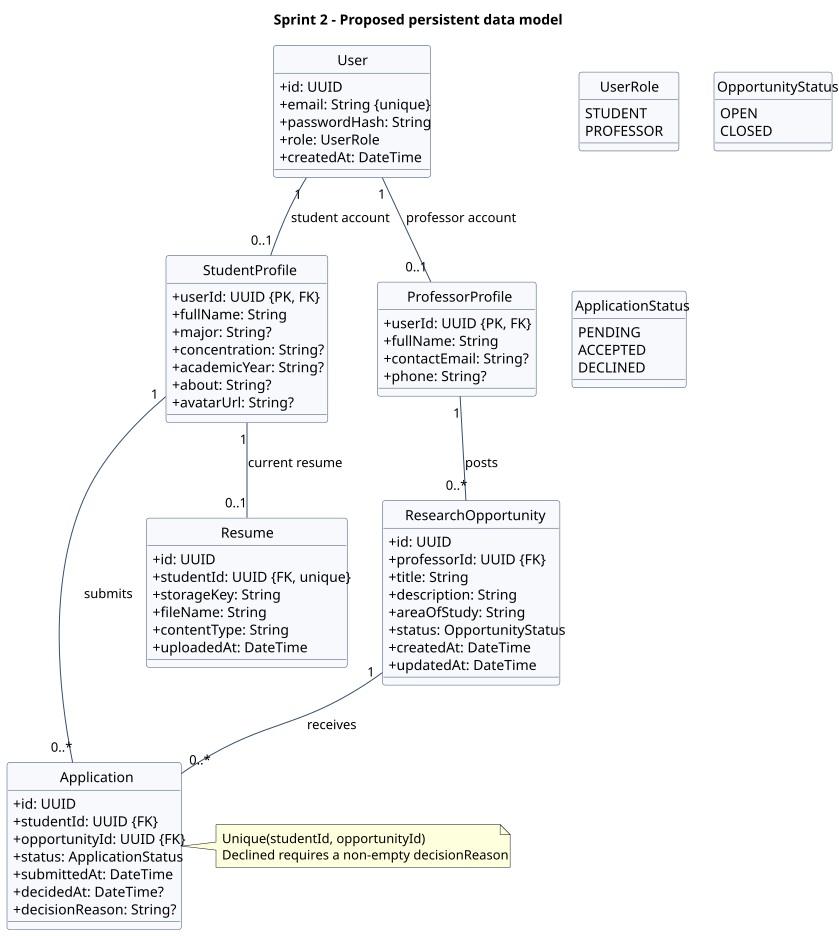

# Sprint 2 Data Model Proposal

## Baseline before Sprint 2

The project is a React 19, TypeScript 5.9, and Vite 7 client application. Its dependencies currently contain no backend, authentication provider, database client, ORM, migration tool, or persistence layer. The login screen and professor dashboard keep their state in React; the README explicitly describes authentication and linked professor sections as unconnected.

The Figma file contains login, research listings, opportunity details, applicant selection, and student profile screens. The profile screen shows a student's name, major/concentration, year, biography, avatar, resume upload, and applied listings. The opportunity screen shows a title, description, professor contact details, and an Apply action. The applicant screens show applicants associated with opportunities.

Relevant open backlog stories:

- [#3 Apply to Research Opportunity Student](https://github.com/npant1/3155implementation/issues/3): view an opportunity and apply.
- [#7 Student Profile](https://github.com/npant1/3155implementation/issues/7): view/edit profile information, upload a resume, and see applied listings.
- [#9 Professor View Applicants](https://github.com/npant1/3155implementation/issues/9): organize applicants by listing, review profiles/resumes, and accept or decline with a reason.
- [#13 Logout](https://github.com/npant1/3155implementation/issues/13): clear the active session and prevent access after logout.
- [#5 Search Feature](https://github.com/npant1/3155implementation/issues/5): search research listings by keywords and areas of study.

## Proposed persistent model

| Entity | Proposed attributes | Purpose and constraints |
|---|---|---|
| `User` | `id`, `email`, `passwordHash`, `role`, `createdAt` | Authentication identity. Email should be unique and normalized. Never persist a plaintext password. Roles are `STUDENT` or `PROFESSOR`. |
| `StudentProfile` | `userId`, `fullName`, `major?`, `concentration?`, `academicYear?`, `about?`, `avatarUrl?` | Student-specific information, one profile per student user. The Figma screen indicates these profile fields. |
| `ProfessorProfile` | `userId`, `fullName`, `contactEmail?`, `phone?` | Professor identity/contact details referenced by opportunity pages. One profile per professor user. |
| `ResearchOpportunity` | `id`, `professorId`, `title`, `description`, `areaOfStudy`, `status`, `createdAt`, `updatedAt` | A professor-owned listing that can be searched and applied to. |
| `Resume` | `id`, `studentId`, `storageKey`, `fileName`, `contentType`, `uploadedAt` | Metadata for a private uploaded file; store the file in protected object storage, not as a database blob. |
| `Application` | `id`, `studentId`, `opportunityId`, `status`, `submittedAt`, `decidedAt`, `decisionReason` | Join entity recording an application and its decision. Enforce one application per student/opportunity. Require a reason for a declined application. |

`Application.status` is `PENDING`, `ACCEPTED`, or `DECLINED`; `ResearchOpportunity.status` is `OPEN` or `CLOSED`. A student has many applications, and an opportunity receives many applications. A professor owns many opportunities. A student profile may have at most one current resume. Profile-to-user links are one-to-one; the future account-provisioning service must ensure a user's role matches its profile type.

The UML models the `Resume` as optional and singular to match the current profile screen. If the team needs resume history or resume selection per application, that decision changes the relationship and should be made before implementation.

## Persistence story selected for the sequence diagram

Issue #3 is the primary persistence flow: an authenticated student applies to a research opportunity. Issue #7 supplies the student profile and resume, while issue #9 describes the professor's later use of the resulting application. The sequence shows a proposed UI -> service -> repository -> database boundary, not a connected API flow.

## Assumptions and open requirements

- The application needs server-side or managed authentication; accepting any username/password as the existing demo does is not account authentication. Authentication is not implemented in this batch.
- A trusted identity/session provider supplies the student or professor ID. The client must not be trusted to assert its own role or identity.
- Applying requires an existing student profile and an open opportunity. The database should enforce the unique `(studentId, opportunityId)` pair; duplicate submissions should return a clear conflict rather than create duplicate rows.
- Declined applications require a reason. Whether accepted applications also have a reason, whether decisions can be changed, and whether students can withdraw applications are unspecified.
- Student profile field requirements, academic-year values, file type/size limits, resume retention, and image/file access policy are unspecified.
- Opportunity lifecycle, deletion/archival behavior, and whether closed listings remain searchable are unspecified.
- No production or development database is configured. Encryption, backups, audit logging, authorization rules, and retention policies are also absent from the current project.
- Names, email addresses, phone numbers, academic history, profile images, and resumes are personal data. Access to resumes and applicant decisions should be restricted to the student and authorized professors; the current UI alone provides no such controls.

## Stack and database recommendation

This repository is a browser-only React/TypeScript/Vite application, so it must not connect directly to a relational database or embed database credentials in frontend code. For a relational choice, PostgreSQL with Prisma is a suitable fit for the related entities, unique constraints, typed TypeScript client, and versioned migrations, but it requires a trusted backend/API not present in this repository. For Firestore, use typed document models and the Firebase SDK with Firebase Authentication and restrictive Firestore/Storage security rules; do not treat frontend configuration values as authorization.

## Implementation status

The approved PostgreSQL path is implemented as a Prisma 7 schema, a PostgreSQL migration, a generated-client access module, and a testable application repository/service boundary. A local Docker Compose database definition and `.env.example` are provided; no live database was available, and no production database was contacted or modified.

The persistent application UI/API remains deferred because the current login is a client-side demo and no trusted identity provider or authentication approach was selected. `ApplicationService` accepts a trusted student ID from its future server-side caller; it is not safe to call directly from browser code until that caller derives identity from an authenticated session. Login/signup, authorization, file storage, and profile-management endpoints remain out of scope.

For relational persistence, the selected stack is PostgreSQL with Prisma 7. The database is configured for local development only. No credentials are committed; each developer must create their own ignored `.env` from `.env.example`.

## UML

PlantUML sources are [class-diagram.puml](./class-diagram.puml) and [application-sequence.puml](./application-sequence.puml). Rendered previews are included below and also saved as SVG.

### Class diagram

### Application sequence

